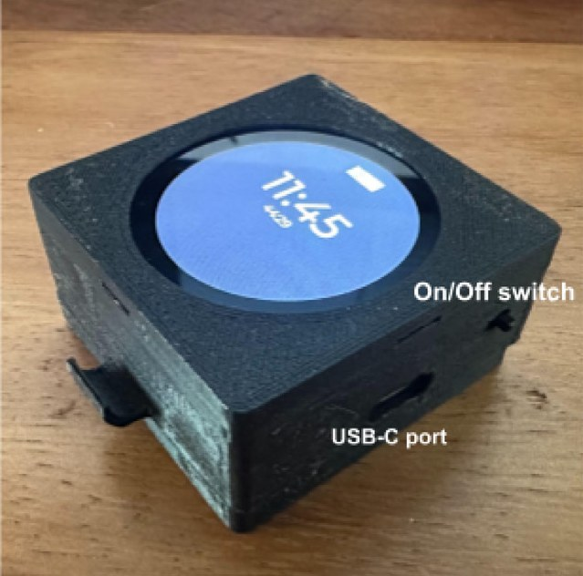
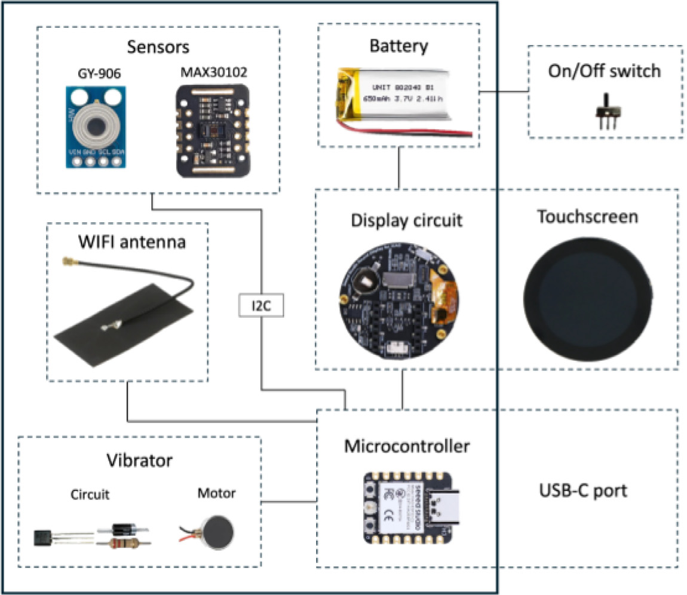
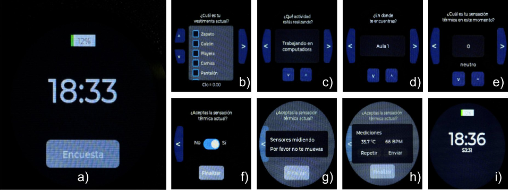
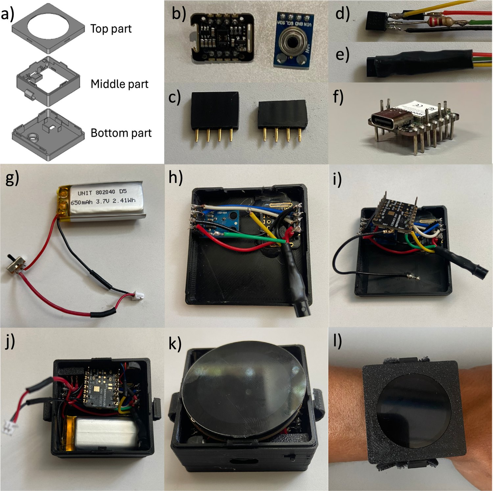
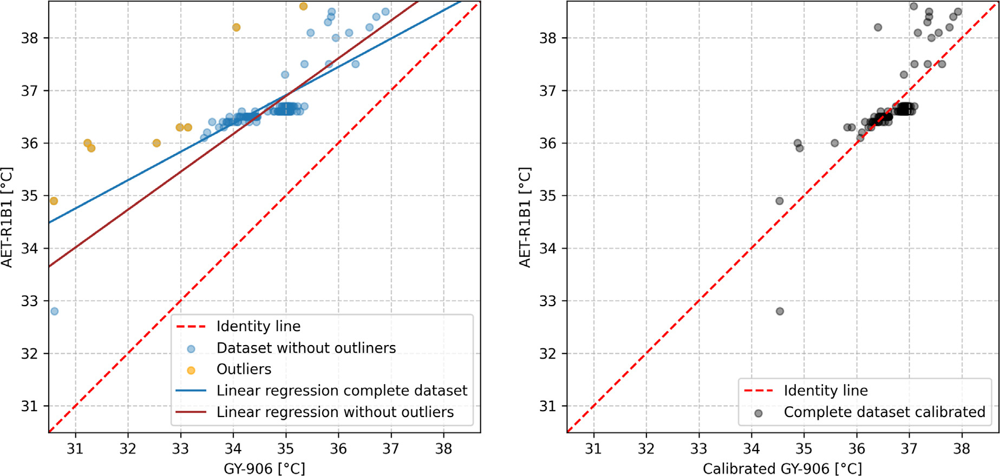
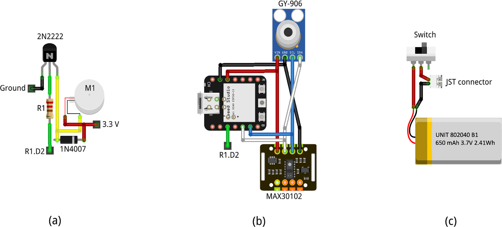
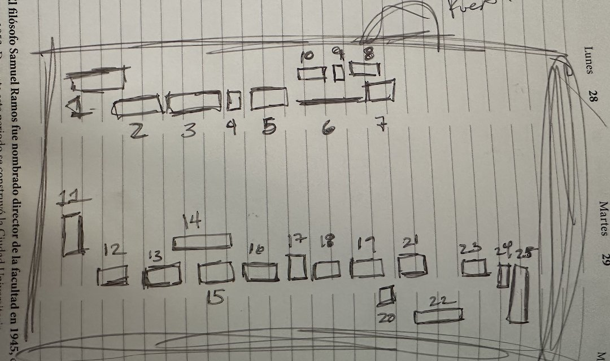

```{python}
#| include: false
# Estilo común de las gráficas y carga de los datos del SITE.
import pandas as pd
import matplotlib.pyplot as plt
from matplotlib.ticker import FuncFormatter
import matplotlib.dates as mdates

TINTA2, TENUE = "#52514e", "#898781"
SERIE = ["#2a78d6", "#eb6834", "#1baf7a", "#eda100", "#e87ba4", "#008300"]  # orden fijo, validado para daltonismo

plt.rcParams.update({
    "figure.facecolor": "white", "axes.facecolor": "white", "savefig.facecolor": "white",
    "font.family": "sans-serif",
    "font.sans-serif": ["Helvetica Neue", "Arial", "DejaVu Sans"],
    "font.size": 13,
    "axes.prop_cycle": plt.cycler(color=SERIE),
    "axes.spines.top": False, "axes.spines.right": False,
    "axes.edgecolor": "#c3c2b7", "axes.labelcolor": TINTA2,
    "xtick.color": TENUE, "ytick.color": TENUE,
    "xtick.labelcolor": TINTA2, "ytick.labelcolor": TINTA2,
    "axes.grid": True, "axes.grid.axis": "y", "axes.axisbelow": True,
    "grid.color": "#e1e0d9", "grid.linewidth": 0.8,
    "lines.linewidth": 2,
    "legend.frameon": False, "legend.labelcolor": TINTA2,
})

MESES = {5: "may", 6: "jun", 7: "jul"}
dia_mes = FuncFormatter(lambda x, _: f"{mdates.num2date(x).day} {MESES[mdates.num2date(x).month]}")

T = pd.read_csv("data/site_temperatura.csv", index_col=0, parse_dates=True)
```

## {.center}

::: {.centro}
{height="500px" fig-alt="Código QR que lleva a la presentación en altamarmx.github.io/hackea"}

[altamarmx.github.io/hackea](https://altamarmx.github.io/hackea/)
:::

::: {.notes}
Mientras la gente se acomoda: escanear el código para seguir las diapositivas
en su celular.
:::

## ¿Quién ha tenido calor en clase? 🥵

<!--
OJO: este comentario va DENTRO de la primera diapositiva (antes del primer ##
revealjs crearía una diapositiva en blanco).

GUION SUGERIDO (~25 min + preguntas)
  0–3    Gancho: calor en clase, hackear = entender para mejorar
  3–7    Bloque 1  Confort térmico y energía
  7–14   Bloque 2  El reloj de 49 dólares (artículo HardwareX 2025)
  14–21  Bloque 3  Del reloj al edificio: SITE, campaña y radiación
  21–25  Bloque 4  Tu turno: hackea tu escuela
-->

- Después del recreo, a las 2 de la tarde, con 40 personas en el salón…
- Unos se duermen, otros se abanican con el cuaderno, alguien pide prender el ventilador.
- Y casi siempre la discusión termina en: *"yo tengo calor"* contra *"pues yo no"*.

::: {.pregunta .enorme}
¿Y si en lugar de discutirlo… lo medimos?
:::

::: {.notes}
Arrancar preguntando a mano alzada: ¿quién ha tenido calor en clase?, ¿quién frío?,
¿quién se ha dormido después del recreo? La idea es que noten que cada quien
siente distinto y que nadie tiene datos.
:::

## Hackear no es romper

Hackear es **entender cómo funciona algo para mejorarlo**. Hoy, tres ingredientes:

::: {.cards}
::: {.card}
[📡]{.icono}
**Sensores**
Miden lo que no vemos: temperatura, pulso, CO₂, radiación.
:::

::: {.card}
[📈]{.icono}
**Datos**
Convierten "yo siento que…" en evidencia que cualquiera puede revisar.
:::

::: {.card}
[⚡]{.icono}
**Energía**
La meta: estar cómodos gastando lo mínimo.
:::
:::

::: {.small}
Y un cuarto ingrediente que lo cambia todo: **hardware libre**. Los planos y el código están abiertos, así que tú también puedes construirlo.
:::

::: {.notes}
Aclarar el sentido "maker" de hackear: curiosidad, abrir la caja negra, mejorarla
y compartir. Regla del buen hacker: con permiso y compartiendo lo aprendido.
:::

# Sentir no es lo mismo que medir {background-color="#10233f"}

[01 / el problema]{.bloque}

## El confort térmico no es solo "la temperatura"

Que te sientas a gusto depende de **seis cosas** a la vez… y de **a qué estás acostumbrado**:

:::: {.columns}
::: {.column width="32%"}
**Del lugar**

- 🌡️ Temperatura del aire
- ☀️ Radiación: el Sol y las superficies calientes
- 💧 Humedad
- 🌬️ Movimiento del aire
:::

::: {.column width="32%"}
**De ti**

- 👕 Tu ropa: se mide en **clo**
- 🏃 Tu actividad: se mide en **met**

::: {.small}
Sentado y tranquilo ≈ 1 met. Después de educación física, mucho más.
:::
:::

::: {.column width="36%"}
**De tu costumbre**

- 🌎 **Adaptación al clima:** tu cuerpo se acostumbra al lugar donde vives.
- ❄️ **Aire acondicionado:** entre más lo usas, menos toleras el calor.
:::
::::

::: {.small}
Por eso en el mismo salón no todos sienten lo mismo, y por eso el confort de alguien de Mexicali no es el de alguien de Toluca.
:::

::: {.notes}
Seis variables clásicas del confort térmico: cuatro ambientales y dos personales.
1 clo ≈ un traje completo; 1 met ≈ persona sentada en reposo.
Además está la adaptación: las personas se aclimatan al clima en el que viven
(es la idea de los modelos adaptativos de confort). Y quien pasa mucho tiempo
con aire acondicionado se desacostumbra al calor: lo tolera menos y termina
necesitando más aire acondicionado, es decir, más energía.
Enlace con el reloj: al registrarse, cada persona responde qué tan seguido usa
aire acondicionado, justo para poder estudiar esto.
Conectar con el gancho: "yo tengo calor / yo no" tiene explicación física.
:::

## Estar cómodos usando aire acondicionado cuesta energía

:::: {.columns}
::: {.column width="42%"}
::: {.datos .col .heroe}
::: {.dato}
[≈ 30 %]{.num}
[de la energía que usa el mundo se consume en operar edificios]{.que}
:::
:::

::: {.fuente}
Fuente: Agencia Internacional de Energía (IEA), seguimiento del sector edificios.
:::
:::

::: {.column width="58%"}
- Si el edificio está mal diseñado, lo "arreglamos" con aire acondicionado, y eso se paga en electricidad.
- **La primera alternativa es el diseño bioclimático:** edificios pensados para su clima, con sombra, ventilación, buena orientación y materiales adecuados.
- El aire acondicionado va al final, solo para lo que el edificio no resuelve.

::: {.pregunta}
El reto: confort térmico con el mínimo de energía.
:::
:::
::::

::: {.notes}
Dato IEA: la operación de edificios representa alrededor de 30 % del consumo
final de energía global. (Verificar la cifra más reciente antes de presentar.)
Diseño bioclimático: adaptar el edificio al clima del lugar para que por sí
solo sea cómodo la mayor parte del tiempo (Olgyay, "Design with Climate",
referencia [1] del artículo). Ejemplos cercanos: un árbol o un alero que
sombrea la ventana, ventilación cruzada, techos claros o aislados.
Mensaje: antes de comprar un aire acondicionado, hay que entender el edificio.
Y para entenderlo hay que medir: al edificio y a las personas.
:::

# Un reloj que te pregunta si tienes calor {background-color="#10233f"}

[02 / el artículo]{.bloque}

## Lo construimos por 49 dólares

:::: {.columns}
::: {.column width="45%"}
{.redonda fig-alt="Reloj inteligente con carcasa negra impresa en 3D y pantalla redonda" height="470px"}
:::

::: {.column width="55%"}
- Un **reloj inteligente** para estudiar el confort térmico de las personas.
- Cada hora te hace una **encuesta** en la pantalla.
- Mide la **temperatura de tu piel** y tu **pulso**.
- Manda todo por **WiFi** a una plataforma en internet.
- Piezas que se compran en línea y carcasa **impresa en 3D**.

::: {.fuente}
J. Landa, G. Barrios, G. Huelsz (2025). *IoT smartwatch based on open technologies for the collection of thermal comfort data.* HardwareX 22, e00633. Acceso abierto (CC BY).
:::
:::
::::

::: {.notes}
El reloj fue la tesis de maestría de Julio Landa en el IER-UNAM. HardwareX es
una revista científica dedicada a publicar hardware abierto: el artículo ES la
receta para construirlo. Lo comercial más parecido sería un Fitbit o un Apple
Watch con una app de encuestas, pero ahí no puedes ver ni cambiar lo de adentro.
:::

## ¿Qué trae adentro?

:::: {.columns}
::: {.column width="46%"}
{fig-alt="Diagrama de bloques del reloj: sensores, batería, pantalla, antena WiFi, vibrador y microcontrolador" height="500px"}
:::

::: {.column width="54%"}
| Pieza | Para qué sirve | USD |
|:--|:--|--:|
| Microcontrolador XIAO ESP32C3 | el cerebro, con WiFi | 7.49 |
| Pantalla táctil redonda | hacerte la encuesta | 18.00 |
| Sensor infrarrojo GY-906 | temperatura de la piel | 16.05 |
| Sensor MAX30102 | pulso | 1.93 |
| Batería LiPo 650 mAh | unas 8 horas de uso | 2.50 |
| Motor vibrador | avisarte de la encuesta | 0.76 |
| Cables, interruptor, carcasa… | | 2.27 |
| **Total** | | **49.00** |
:::
::::

::: {.notes}
El microcontrolador mide 21 × 17.5 mm: más chico que una estampilla, con WiFi y
Bluetooth. Los dos sensores hablan con el cerebro por el mismo par de cables
(I2C); por eso es fácil cambiarlos o agregar otros.
Las correas son cinchos de plástico: no todo tiene que ser sofisticado.
:::

## ¿Cómo funciona?

{fig-alt="Pantallas del reloj: inicio, ropa, actividad, ubicación, sensación térmica, aceptación, medición y resultados" height="350px"}

::: {.flujo}
::: {.paso}
<b>1 · Vibra</b>Cada hora te avisa que toca encuesta
:::
[→]{.flecha}

::: {.paso}
<b>2 · Pregunta</b>Ropa, actividad, dónde estás y qué sientes, de −3 (mucho frío) a +3 (mucho calor)
:::
[→]{.flecha}

::: {.paso}
<b>3 · Mide</b>Temperatura de la piel de tu muñeca y pulso
:::
[→]{.flecha}

::: {.paso}
<b>4 · Envía</b>Todo sube por WiFi a la nube
:::
:::

::: {.notes}
¿Por qué la muñeca? Varios estudios encontraron que la temperatura de la piel
de la muñeca es buen indicador de si la persona siente frío o calor.
La plataforma es ThingsBoard, también de código abierto. Los datos se
descargan con Python.
Con muchas personas usando el reloj se pueden construir modelos de confort
propios de cada lugar y clima.
:::

## Se arma en una mesa

:::: {.columns}
::: {.column width="52%"}
{.redonda fig-alt="Doce fotos del proceso de armado del reloj" height="540px"}
:::

::: {.column width="48%"}
- La carcasa son **tres capas impresas en 3D** que encajan a presión.
- Los sensores van con conectores: se quitan y se ponen sin soldar de nuevo.
- Cautín, soldadura, un poco de silicón y paciencia.
- El programa se carga desde la computadora con **Arduino**, que es gratis.

::: {.small}
Ningún paso necesita un laboratorio. Necesita ganas de intentarlo… y de equivocarse un par de veces.
:::
:::
::::

::: {.notes}
Recorrer las fotos: a) las tres partes de la carcasa, b) los sensores,
g) batería e interruptor, h–j) cómo se acomoda todo, l) el reloj puesto.
:::

## Barato no es malo, pero hay que calibrar

:::: {.columns}
::: {.column width="62%"}
{fig-alt="Gráficas de calibración: mediciones del sensor contra el termómetro de referencia, antes y después de calibrar" width="100%"}

::: {.small}
Cada punto compara el sensor del reloj con un termómetro de referencia. Si fueran idénticos, caerían sobre la línea punteada. Izquierda: de fábrica. Derecha: calibrado.
:::
:::

::: {.column width="38%"}
::: {.datos .col}
::: {.dato}
[≈ 2 °C]{.num}
[de menos marcaba el sensor de temperatura recién salido de la caja]{.que}
:::

::: {.dato}
[< 0.5 °C]{.num}
[de error promedio después de calibrarlo con 115 comparaciones]{.que}
:::

::: {.dato}
[18.5 → 3.6]{.num}
[latidos por minuto de error en el pulso, antes y después de ajustarlo]{.que}
:::
:::
:::
::::

::: {.notes}
Mensaje clave: un sensor sin calibrar es una opinión. Calibrar = comparar
contra un instrumento en el que confías y corregir.
Temperatura: promedio 34.6 °C del sensor contra 36.7 °C de la referencia;
una recta de ajuste lo corrige. Pulso: se ajustaron dos parámetros del sensor.
:::

## Hardware libre: la receta está abierta

:::: {.columns}
::: {.column width="52%"}
::: {.cards .dos}
::: {.card}
[🧊]{.icono}
**Planos 3D**
La carcasa, lista para imprimir (FreeCAD).
:::

::: {.card}
[🔌]{.icono}
**Conexiones**
Qué cable va a dónde.
:::

::: {.card}
[💻]{.icono}
**Código**
El programa del reloj y sus pantallas (Arduino).
:::

::: {.card}
[🐍]{.icono}
**Datos**
Un cuaderno de Python para descargarlos.
:::
:::

::: {.small}
Licencias libres: puedes **usarlo, modificarlo y compartirlo**. Los archivos están en español, a propósito. Descarga: [doi.org/10.5281/zenodo.14835096](https://doi.org/10.5281/zenodo.14835096)
:::
:::

::: {.column width="48%"}
{fig-alt="Diagrama de conexiones del motor vibrador, los sensores con el microcontrolador y la batería" width="100%"}

::: {.tiny .centro}
El diagrama de conexiones, tal como está publicado.
:::
:::
::::

::: {.notes}
Licencias: GPLv3 para el código y CERN OHL para el diseño. Cualquiera puede
construir el reloj, mejorarlo (otra carcasa, más sensores) y publicar su versión.
Eso es lo que distingue al hardware libre de un producto comercial.
:::

# Del reloj al edificio {background-color="#10233f"}

[03 / lo que estamos midiendo hoy]{.bloque}

## El SITE: un cuarto que nunca descansa

:::: {.columns}
::: {.column width="50%"}
{.redonda fig-alt="Croquis a mano del cuarto de servidores con los equipos numerados" width="100%"}

::: {.tiny .centro}
Así empieza: un croquis a mano, con cada equipo numerado.
:::
:::

::: {.column width="50%"}
- El SITE es el **cuarto de servidores** de nuestro instituto: la red, los servidores y el supercómputo.
- Las computadoras **producen calor** día y noche.
- El **aire acondicionado** trabaja las 24 horas para sacarlo.

::: {.pregunta}
¿Cuánta energía necesita de verdad ese aire acondicionado?
:::
:::
::::

::: {.notes}
Para responder hay que saber dos cosas: cuánto calor producen los equipos
(inventario y potencia de cada uno) y qué temperatura hay realmente adentro.
Por eso el croquis y por eso los sensores.
:::

## Seis sensores, cinco semanas

::: {.datos}
::: {.dato}
[6]{.num}
[sensores de temperatura repartidos en el cuarto]{.que}
:::

::: {.dato}
[30 s]{.num}
[entre una lectura y la siguiente]{.que}
:::

::: {.dato}
[623 419]{.num}
[lecturas del 25 de mayo al 1 de julio de 2026]{.que}
:::

::: {.dato}
[20 330]{.num}
[lecturas decían 0.00 °C: 3 de cada 100]{.que}
:::
:::

- Un 0.00 °C en un cuarto lleno de computadoras no es frío: es **un sensor fallando**.
- Antes de sacar conclusiones, los datos **se revisan y se limpian**.
- Ninguna persona podría anotar 600 mil números a mano. Un sensor de bajo costo, sí.

::: {.notes}
Los ceros vienen casi todos de dos de los seis sensores. Lección: los datos
también se equivocan; quien analiza tiene que conocer su instrumento.
Los sensores publican a la misma plataforma abierta que usa el reloj.
:::

## Cinco semanas en una gráfica

```{python}
#| fig-align: center
#| fig-alt: "Temperatura promedio por hora en el SITE del 26 de mayo al 1 de julio de 2026, con un pico el 18 de junio"
hora = T.resample("1h").mean()
media, lo, hi = hora.mean(axis=1), hora.min(axis=1), hora.max(axis=1)

fig, ax = plt.subplots(figsize=(12, 4.4))
ax.fill_between(hora.index, lo, hi, color=SERIE[0], alpha=0.25, linewidth=0,
                label="Del sensor más frío al más caliente")
ax.plot(media.index, media, color=SERIE[0], label="Promedio de los 6 sensores")

pico = hi.idxmax()
ax.annotate(f"18 de junio:\nmás de {int(hi.max())} °C", xy=(pico, hi.max()),
            xytext=(pico - pd.Timedelta(days=7.5), hi.max() - 1.2),
            color=TINTA2, fontsize=13, ha="left", va="center",
            arrowprops=dict(arrowstyle="-", color=TENUE, linewidth=1))

ax.set_ylabel("Temperatura [°C]")
ax.set_ylim(19, 31.5)
ax.xaxis.set_major_locator(mdates.WeekdayLocator(byweekday=mdates.MO))
ax.xaxis.set_major_formatter(dia_mes)
ax.margins(x=0.01)
ax.legend(loc="upper left")
plt.show()
```

::: {.small}
Casi siempre entre **21 y 24 °C**: el aire acondicionado hace su trabajo. Hasta que un día, no.
:::

::: {.notes}
Promedios por hora. La franja muestra la diferencia entre el sensor más frío
y el más caliente a la misma hora. Dejar que el público encuentre el pico
antes de señalarlo.
:::

## De los datos a la gráfica en 5 líneas

```{python}
#| echo: true
#| output-location: column
#| fig-alt: "Temperatura de los seis sensores el 18 de junio de 2026, de las 10 a las 21 horas"
import pandas as pd

T = pd.read_csv("data/site_temperatura.csv",
                index_col=0, parse_dates=True)
dia = T.loc["2026-06-18 10:00":"2026-06-18 21:00"]
dia.plot(ylabel="Temperatura [°C]")
```

::: {.pregunta}
18 de junio, 2 de la tarde. ¿Qué crees que pasó?
:::

::: {.notes}
Python y pandas son gratis; esto corre en cualquier computadora.
Leer la gráfica con el público: a las 14:15 todo empieza a subir; cuatro
sensores pasan de 30 °C hacia las 16:45; uno (S5) hace lo contrario y baja.
A las 18:00 todo vuelve a la normalidad.
PENDIENTE (Guillermo): contar aquí qué ocurrió ese día con el aire acondicionado.
Sin sensores nadie se habría enterado: ese es el punto.
:::

## Un cuarto no tiene *una* temperatura

```{python}
#| fig-align: center
#| fig-alt: "Temperatura promedio de cada sensor según la hora del día"
ciclo = T.groupby(T.index.hour).mean()

fig, ax = plt.subplots(figsize=(12, 4.0))
for sensor, color in zip(ciclo.columns, SERIE):
    ax.plot(ciclo.index, ciclo[sensor], color=color, label=sensor)

ax.set_xlabel("Hora del día")
ax.set_ylabel("Temperatura promedio [°C]")
ax.set_xticks(range(0, 24, 3))
ax.set_xlim(0, 23)
ax.set_ylim(20.5, 24.3)
ax.legend(loc="upper left", ncols=6, columnspacing=1.4, handlelength=1.4)
plt.show()
```

::: {.small}
A la misma hora hay unos **2 °C de diferencia** según dónde esté el sensor. Y el día se nota: lo más caliente es a las 4 de la tarde.
:::

::: {.notes}
Promedio de las cinco semanas para cada hora del día. Pregunta para el público:
si solo tuvieras UN termómetro, ¿dónde lo pondrías? ¿Junto a la salida del
aire o detrás de los servidores? La respuesta cambia la conclusión.
:::

## Medir para simular

Dos estudiantes de nuestro grupo están midiendo un edificio real con **Arduino** y **Raspberry Pi**.

::: {.flujo}
::: {.paso}
<b>Medir</b>Sensores de bajo costo registran qué pasa en el edificio
:::
[→]{.flecha}

::: {.paso}
<b>Simular</b>Con esos datos se arma un modelo del edificio en EnergyPlus
:::
[→]{.flecha}

::: {.paso}
<b>Probar ideas</b>¿Y si sombreamos la ventana? ¿Y si cambiamos el techo?
:::
[→]{.flecha}

::: {.paso}
<b>Mejorar</b>Se construye solo lo que el modelo dice que funciona
:::
:::

- **EnergyPlus** es un programa libre y gratuito para simular la energía de un edificio.
- Es como tener un **edificio de prueba dentro de la computadora**: puedes equivocarte sin gastar un peso.
- Las mediciones sirven para comprobar que el modelo se parece a la realidad.

::: {.notes}
<!-- Sugerencia: nombrar aquí a las dos estudiantes/los dos estudiantes y mostrar una foto del montaje. -->
EnergyPlus lo desarrolla el Departamento de Energía de EE. UU. y es de código abierto.
Meta de la campaña: lograr confort térmico con el mínimo consumo de energía.
:::

## El calor que el termómetro no ve

:::: {.columns}
::: {.column width="60%"}
```{=html}
<svg viewBox="0 0 760 440" role="img" aria-label="Esquema de un salón: la luz del Sol entra por la ventana (onda corta) y el techo caliente emite calor hacia la persona (onda larga)" style="width:100%;height:auto;font-family:inherit">
  <defs>
    <marker id="pc" viewBox="0 0 10 10" refX="8" refY="5" markerWidth="7" markerHeight="7" orient="auto"><path d="M0 0L10 5L0 10z" fill="#d99a00"/></marker>
    <marker id="pl" viewBox="0 0 10 10" refX="8" refY="5" markerWidth="7" markerHeight="7" orient="auto"><path d="M0 0L10 5L0 10z" fill="#d03b3b"/></marker>
  </defs>
  <!-- Sol -->
  <circle cx="78" cy="70" r="40" fill="#f2c200"/>
  <!-- Techo caliente, muros y piso -->
  <rect x="236" y="92" width="500" height="28" rx="4" fill="#ec835a"/>
  <rect x="250" y="120" width="12" height="50" fill="#9aa3ad"/>
  <rect x="250" y="290" width="12" height="100" fill="#9aa3ad"/>
  <rect x="253" y="170" width="6" height="120" fill="#b7d3f6"/>
  <rect x="710" y="120" width="12" height="270" fill="#9aa3ad"/>
  <rect x="236" y="390" width="500" height="10" fill="#9aa3ad"/>
  <!-- Onda corta: rayos rectos -->
  <g stroke="#d99a00" stroke-width="4" fill="none" marker-end="url(#pc)">
    <line x1="124" y1="62" x2="300" y2="86"/>
    <line x1="128" y1="78" x2="420" y2="86"/>
    <line x1="112" y1="100" x2="422" y2="312"/>
    <line x1="98" y1="112" x2="350" y2="384"/>
  </g>
  <!-- Onda larga: flechas onduladas desde el techo -->
  <g stroke="#d03b3b" stroke-width="4" fill="none" marker-end="url(#pl)">
    <path d="M380 124 q12 12 0 24 q-12 12 0 24 q12 12 0 24 l0 12"/>
    <path d="M450 124 q12 12 0 24 q-12 12 0 24 q12 12 0 24 l0 12"/>
    <path d="M520 124 q12 12 0 24 q-12 12 0 24 q12 12 0 24 l0 12"/>
  </g>
  <!-- Persona -->
  <g fill="#1b3a6b">
    <circle cx="450" cy="262" r="20"/>
    <rect x="428" y="288" width="44" height="62" rx="12"/>
    <rect x="432" y="344" width="14" height="46" rx="5"/>
    <rect x="454" y="344" width="14" height="46" rx="5"/>
  </g>
  <!-- Termómetro del aire -->
  <rect x="580" y="282" width="116" height="72" rx="10" fill="#f2f5f9" stroke="#c3c2b7"/>
  <text x="638" y="308" text-anchor="middle" font-size="18" fill="#5f6b7a">Aire</text>
  <text x="638" y="340" text-anchor="middle" font-size="28" font-weight="700" fill="#1b3a6b">24 °C</text>
  <!-- Etiquetas -->
  <text x="14" y="236" font-size="24" font-weight="700" fill="#8a6200">Onda corta</text>
  <text x="14" y="262" font-size="19" fill="#52514e">luz del Sol</text>
  <text x="562" y="158" font-size="24" font-weight="700" fill="#b02a2a">Onda larga</text>
  <text x="562" y="184" font-size="19" fill="#52514e">calor que emite</text>
  <text x="562" y="207" font-size="19" fill="#52514e">el techo caliente</text>
</svg>
```
:::

::: {.column width="40%"}
- **Onda corta:** la luz del Sol que entra por la ventana y te pega directo.
- **Onda larga:** el calor que te mandan el techo y las paredes cuando se calientan.
- El termómetro del aire puede decir 24 °C… y tú, junto a la ventana, sentirte asándote.

::: {.small}
Ese es el objetivo de nuestra campaña: **reducir la incomodidad que causa la radiación**, con el mínimo de energía.
:::
:::
::::

::: {.notes}
Ejemplo cotidiano: en un día fresco, al sol se siente calor y a la sombra no,
con la misma temperatura del aire. Eso es radiación de onda corta.
Y una pared o un techo que estuvieron al sol siguen "mandándote calor" en
infrarrojo (onda larga) aunque el Sol ya no te dé.
Bajar el termostato del aire acondicionado no arregla esto de forma eficiente;
sombrear, aislar o cambiar superficies, sí.
:::

# Tu turno: hackea tu escuela {background-color="#10233f"}

[04 / manos a la obra]{.bloque}

## Preguntas que tu escuela todavía no responde

- ¿Cuál es el **salón más caliente** y a qué hora?
- ¿Se siente igual junto a la **ventana** que al fondo del salón?
- ¿Cuánto sube el **CO₂** con 40 personas y las ventanas cerradas?
- ¿Sirve abrir la puerta? ¿Y prender el ventilador?
- ¿Qué cambia si ponemos una **cortina** o una **sombra** en la ventana?

::: {.pregunta}
Nadie tiene esos datos. Ustedes pueden ser los primeros.
:::

::: {.notes}
Invitar a que propongan sus propias preguntas. Una buena pregunta es una que
se puede responder midiendo. El CO₂ es un buen indicador de ventilación:
tenemos también un monitor de CO₂ abierto (github.com/AltamarMx/co2).
:::

## Tu primer sensor: 10 líneas

:::: {.columns}
::: {.column width="55%"}
::: {.grande}
```cpp
#include <Adafruit_MLX90614.h>

Adafruit_MLX90614 sensor;

void setup() {
  Serial.begin(115200);
  sensor.begin();
}

void loop() {
  Serial.println(sensor.readObjectTempC());
  delay(30000);  // una lectura cada 30 s
}
```
:::
:::

::: {.column width="45%"}
**Lo que necesitas**

- Un microcontrolador con WiFi (el del reloj cuesta unos 7.50 dólares).
- Un sensor. Este es el infrarrojo del reloj: mide temperatura **sin tocar**.
- Cuatro cables y un cable USB.
- Arduino en tu computadora: gratis.

::: {.small}
Apúntalo a la pared, al techo, a la ventana… y compara.
:::
:::
::::

::: {.ojo}
**Ojo con la emisividad.** Cada material emite calor de forma distinta: no es lo mismo la piel, una pared pintada o un metal brillante. El sensor necesita ese dato; en el reloj usamos 0.98, la emisividad de la piel. Para medir bien no basta con programar: hay que saber **transferencia de calor**.
:::

::: {.notes}
El programa completo: prende el sensor y cada 30 segundos escribe la
temperatura de lo que tenga enfrente. Con este mismo sensor se puede "ver"
la onda larga: el techo caliente contra una pared a la sombra.
Emisividad: qué tan bien emite radiación infrarroja una superficie, de 0 a 1.
El sensor calcula la temperatura a partir de la radiación que recibe, así que
si la emisividad configurada no corresponde al material, la lectura sale mal
(un metal pulido puede marcar muchos grados de menos). El sensor permite
ajustarla. Mensaje: la electrónica y el código son la mitad; la otra mitad es
entender la física de lo que se mide.
:::

## La receta

::: {.flujo}
::: {.paso}
<b>1 · Pregunta</b>Algo que te dé curiosidad y se pueda medir
:::
[→]{.flecha}

::: {.paso}
<b>2 · Mide</b>Con sensores de bajo costo
:::
[→]{.flecha}

::: {.paso}
<b>3 · Calibra</b>Y limpia tus datos: los sensores también fallan
:::
[→]{.flecha}

::: {.paso}
<b>4 · Analiza</b>Una gráfica vale más que mil opiniones
:::
[→]{.flecha}

::: {.paso}
<b>5 · Propón</b>Un cambio concreto para tu escuela
:::
[→]{.flecha}

::: {.paso}
<b>6 · Comparte</b>Para que otra escuela lo repita
:::
:::

- Es lo mismo que hicimos con el reloj, con el SITE y con el edificio.
- La única diferencia entre un proyecto escolar y uno de investigación es **cuánto cuidas cada paso**.

::: {.notes}
Cerrar el círculo: pregunta (¿quién tiene calor?), medición (reloj, sensores),
desconfianza (calibración, ceros), análisis (gráficas), propuesta (simulación),
compartir (hardware libre, artículo abierto).
:::

## Para seguir hackeando {background-color="#10233f"}

:::: {.columns}
::: {.column width="58%"}
- **El artículo del reloj** (abierto): [doi.org/10.1016/j.ohx.2025.e00633](https://doi.org/10.1016/j.ohx.2025.e00633)
- **Planos y código**: [doi.org/10.5281/zenodo.14835096](https://doi.org/10.5281/zenodo.14835096)
- **Monitor de CO₂ abierto**: [github.com/AltamarMx/co2](https://github.com/AltamarMx/co2)
- **Arduino**: [arduino.cc](https://www.arduino.cc/)
- **EnergyPlus**: [energyplus.net](https://energyplus.net/)
:::

::: {.column width="42%"}
::: {.pregunta}
Mide. Comparte. Mejora tu escuela.
:::

::: {.small}
Guillermo Barrios del Valle<br>Instituto de Energías Renovables, UNAM<br>Temixco, Morelos
:::
:::
::::

::: {.notes}
Agradecimientos: Julio Landa y Guadalupe Huelsz (coautores del artículo);
el reloj se desarrolló con apoyo de UNAM-PAPIIT IT103023.
<!-- Agregar aquí la clave del proyecto PAPIME de la feria y, si quieres, un QR a estas diapositivas. -->
:::
